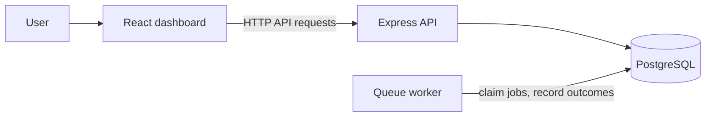
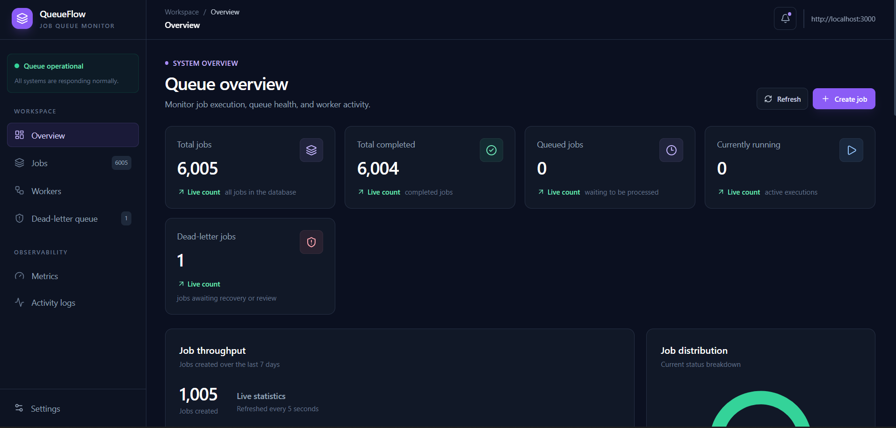
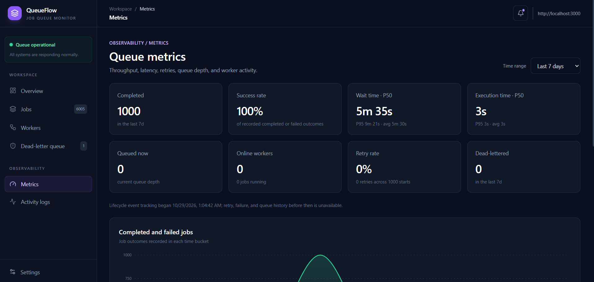

# Job Queue

A PostgreSQL-backed job queue with a React dashboard for submitting jobs and monitoring workers, retries, failures, and queue metrics. Jobs support priorities, idempotency, retry scheduling, and a dead-letter queue.

## Features

- **Job API:** Create jobs with JSON payloads, priorities, retry limits, and optional idempotency keys; list and inspect jobs with status/priority filters and pagination.
- **Worker processing:** Workers claim queued jobs, report heartbeats, and update job state as work completes.
- **Failure handling:** Failed jobs retry with exponential backoff, exhausted jobs move to the dead-letter queue, and interrupted running jobs can be recovered after a worker stops.
- **Manual recovery:** Inspect dead-lettered jobs and retry them from the dashboard.
- **Operations dashboard:** View queue totals and job status, create jobs, browse and inspect jobs, and monitor worker health and active work.
- **Metrics and history:** Review throughput, failures, retries, wait/execution times, and queue trends over selectable time ranges; filter and page through timestamped activity events by type or job status.
- **Dashboard settings:** Choose the data refresh interval.
- **PostgreSQL persistence:** Store jobs, workers, idempotency records, and lifecycle events in PostgreSQL.

## Architecture



The dashboard submits and monitors jobs through the API. Workers claim jobs from PostgreSQL and write back status changes and lifecycle events.

## Try the API

With the API and a worker running, submit a sample job:

```sh
curl -X POST http://localhost:3000/jobs \
  -H "Content-Type: application/json" \
  -d '{"type":"demo","payload":{"message":"Hello from the queue"},"priority":1,"idempotency_key":"readme-demo-001"}'
```

The response includes the new job ID. Use it to inspect the job; after the worker processes it, its status should be `COMPLETED`:

```sh
curl http://localhost:3000/jobs/ID
```

Replace `ID` with the numeric ID returned by the create request.

Change the idempotency key before submitting another job. Reusing the same key returns the existing job as a conflict instead of creating a duplicate.

## Run locally

Copy `.env.example` to `.env`, set the PostgreSQL connection values, create the database, and apply `db/schema.sql`. Install dependencies from the repository root and the `client` directory:

```sh
npm install
cd client
npm install
```

Start the API in a terminal at the repository root:

```sh
npm run dev
```

Start a worker in a second terminal at the repository root:

```sh
node src/workers/worker.js
```

Start the dashboard in a third terminal from `client`:

```sh
npm run dev
```

## Tests

Create a separate PostgreSQL database named `job_queue_test`, apply `db/schema.sql`, and set `TEST_DB_HOST`, `TEST_DB_PORT`, `TEST_DB_NAME`, `TEST_DB_USER`, and `TEST_DB_PASSWORD` in `.env`. The test database name is checked by the app as a safeguard. Run:

```sh
npm test
```

## Load test

Start the API and at least one worker, then run `node load-test/run.js`. It submits 1,000 synthetic jobs by default and reports API latency, submission throughput, completion rate, and queue wait/completion times. Set `BASE_URL`, `TOTAL_JOBS`, `CONCURRENCY`, `POLL_INTERVAL_MS`, and `TIMEOUT_MS` to adjust the run. The script connects using the regular `DB_*` settings and leaves benchmark jobs in the database; use a disposable database for load tests.

## Limitations

- The worker currently simulates job execution with a configurable delay; it does not dispatch real application tasks by job type.
- The API and dashboard do not include authentication or authorization, so they are intended for local development and demos, not direct public deployment.
- The load test is a synthetic end-to-end check, not a production capacity benchmark; results depend on the machine and database used.

## Dashboard preview



## Metrics preview


